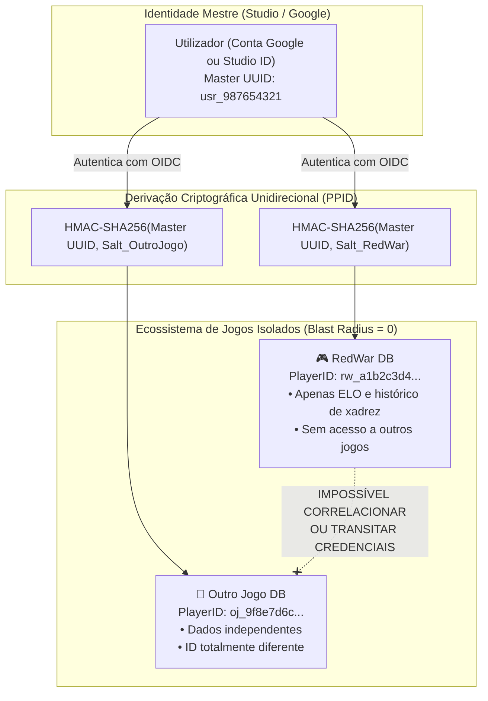

# 🛡️ RedWar Security Architecture & Identity Federation

## 📌 1. Visão Geral e o Dilema Estratégico

Uma das decisões de engenharia de segurança mais críticas no desenvolvimento de videojogos online é o modelo de identidade:
- **Dilema**: Devemos ter uma conta centralizada para todos os jogos do estúdio/criador ou contas completamente isoladas por jogo?
- **Risco**: Se a base de dados de um jogo sofrer uma brecha de segurança (*data breach*), o invasor poderá utilizar as credenciais obtidas para comprometer os outros jogos do estúdio e a reputação de toda a comunidade?

A resposta preconizada pelos tratados de segurança de computadores modernos (**Anderson, 2020; Saltzer & Schroeder, 1975**) e adotada por plataformas líderes da indústria (como **Riot Games, Valve/Steam e Epic Games**) é a **Federação de Identidade com Identificadores Criptográficos Par-a-Par (*Pairwise Pseudonymous Subject Identifiers - PPID*) e Raio de Explosão Zero (*Zero Blast Radius*)**.

---

## 🏛️ 2. Fundamentação Teórica e Padrões Internacionais

### A. Literatura Académica de Referência
1. **Ross Anderson (2020)** — *Security Engineering: A Guide to Building Dependable Distributed Systems* (3ª Edição, Wiley):
   - Tratado sobre a falha de sistemas distribuídos e o princípio da **Compartimentalização**: a segurança de um ecossistema depende de compartimentos estanques, onde a quebra de uma barreira periférica não compromete o núcleo nem os compartimentos vizinhos.
2. **Jerome H. Saltzer & Michael D. Schroeder (1975)** — *The Protection of Information in Computer Systems* (Proceedings of the IEEE):
   - **Principle of Least Privilege**: cada componente deve operar usando exclusivamente o menor conjunto de privilégios e dados necessários para a sua tarefa.
   - **Economy of Mechanism**: desenhos simples e verificáveis minimizam vetores de ataque.
   - **Fail-safe Defaults**: por defeito, a identidade é anónima (Guest Mode).

### B. Normas e Padrões Globais
- **NIST SP 800-63B** (*Digital Identity Guidelines: Authentication and Lifecycle Management*):
  - Diretrizes para gestão de segredos, autenticação federada e funções de derivação de chave com resistência comprovada a GPU/ASIC (**Argon2id**, RFC 9106).
- **OWASP Application Security Verification Standard (ASVS v4.0.3)**:
  - V2: Verificação de Autenticação (prevenção de enumeração de utilizadores, resistência a ataques de dicionário e temporização constante).
  - V3: Gestão de Sessões (tokens JWT com expiração curta, restrição de audiência e rotação).
- **OpenID Connect Core 1.0 (Secção 8: Subject Identifier Types)**:
  - Especificação dos identificadores de utilizador: tipo `public` vs tipo `pairwise`.
- **RFC 7636**: *Proof Key for Code Exchange by OAuth Public Clients (PKCE)*.
- **RFC 8725**: *JSON Web Token Best Current Practices*.

---

## 💥 3. Análise de Incidentes Históricos na Indústria de Jogos

| Incidente Histórico | Ano | Causa Raiz do Ataque | Consequência | Lição Aplicada no RedWar |
|---|---|---|---|---|
| **Sony PlayStation Network** | 2011 | Falta de segmentação interna e armazenamento de credenciais em texto claro / salt fraco. | 77 milhões de contas expostas; rede desativada por 23 dias; perdas superiores a \$171M. | **Blast Radius Zero**: Bases de dados de jogos individuais nunca guardam credenciais mestres nem senhas em texto claro. |
| **Riot Games (League of Legends)** | 2012 | Contas do jogo acopladas diretamente à infraestrutura local sem federação. | Brecha parcial de credenciais em servidores locais. | Adoção do **Riot ID** com OIDC federado e tokens de curta duração restritos por audiência (`aud: "redwar"`). |
| **Electronic Arts (FIFA)** | 2021 | Seqüestro de tokens de sessão e abuso de redefinição sem validação de origem. | Contas de jogadores e influenciadores invadidas e ativos transferidos. | **Validação de Token Criptográfica com PKCE e Nonce Anti-Replay**. |
| **Capcom Ransomware** | 2020 | Servidor legado sem MFA/OIDC usado como porta de entrada lateral. | Vazamento de código-fonte e dados confidenciais de títulos futuros. | **Delegação a provedores de identidade seguros (Google OIDC com 2FA/Passkeys nativos)**. |

---

## 🧩 4. A Arquitetura de Raio de Explosão Zero do RedWar

### Como a matemática garante a separação:
1. O servidor do RedWar recebe apenas o identificador derivado:
   $$\text{PlayerID}_{\text{RedWar}} = \text{HMAC-SHA256}(\text{MasterID}, \text{Salt}_{\text{RedWar}})$$
2. Se um invasor obtiver acesso total à base de dados do RedWar:
   - Ele **NÃO obtém** a palavra-passe mestre.
   - Ele **NÃO obtém** o e-mail ou dados da conta Google.
   - Ele **NÃO consegue** deduzir o $\text{PlayerID}_{\text{OutroJogo}}$ devido à propriedade de unidirecionalidade (*pre-image resistance*) da função hash criptográfica SHA-256.
   - Os tokens emitidos contêm a claim `aud: "redwar-client"` e são rejeitados de imediato por qualquer outro jogo ou serviço.

---

## 🗂️ 5. Os Três Níveis de Autenticação do RedWar

1. **Nível 1: Convidado / RedWar ID Anónimo (Privacidade Total)**:
   - Gerado localmente com `UUIDv4` e assinatura HMAC de integridade.
   - Zero dados recolhidos (sem e-mail, sem nome real).
   - Permite jogar de imediato e aprender as regras sem qualquer atrito.
2. **Nível 2: Conectar com Google (OIDC / PKCE)**:
   - Autenticação com 1 clique usando o Google Identity Services.
   - O jogo solicita apenas `openid` e `profile` básico.
   - Herda a segurança multi-fator da Google (2FA, alertas de dispositivo, biometria).
   - Sincroniza progresso e ELO entre Web e Mobile com segurança militar.
3. **Nível 3: Conta Dedicada Studio RedWar**:
   - Para jogadores que recusam utilizar contas Google.
   - Protegida com **Argon2id** (m=65536, t=3, p=4) ou PBKDF2-HMAC-SHA256 com 600.000 iterações (OWASP 2023).
   - Comparação de credenciais em tempo constante (`hmac.compare_digest`) para anular *timing attacks*.
   - Totalmente independente e estanque de quaisquer outros projetos do estúdio.
